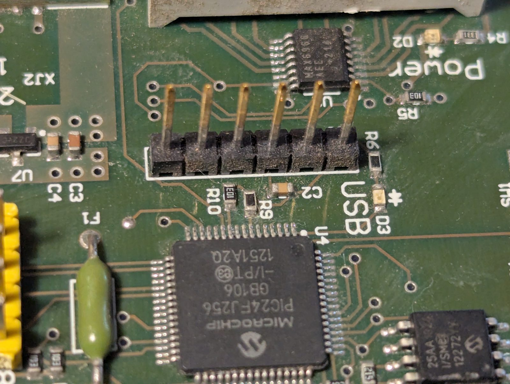

# Reading the controller with an MPLAB PICkit 5

The QM-RDK controller is U4, a Microchip PIC24FJ256GB106-I/PT. J1, the
populated 6-pin right-angle header beside it, is a standard Microchip ICSP
header. The procedure below reads the firmware without erasing or
programming anything.



## J1

| J1 pin | Signal | Board connection |
|---|---|---|
| 1 | MCLR | U4 pin 7 through series resistor R9; R10 is the pull-up to VDD |
| 2 | VDD | 3.3 V rail |
| 3 | GND | ground (same net as the odd pins of XJ1) |
| 4 | PGD | ICSP data |
| 5 | PGC | ICSP clock |
| 6 | NC | |

The configuration word selects ICS pair 1 (PGEC1/PGED1, U4 pins 15/16) for
debugging; programming and reading work on any pair, so this does not
affect the procedure.

The PICkit 5 socket fits J1 directly: the PICkit's ▼ (pin 1) goes on J1
pin 1, PICkit sockets 1–6 take J1 pins 1–6, and sockets 7 and 8 overhang
the end. Support the PICkit so its weight does not lever the header.

Checks before the first connection: J1 pin 3 to an odd XJ1 pin reads 0 Ω
unpowered; with the board powered, J1 pins 1 and 2 both read 3.3 V.

## Safety

* The board powers itself from its own USB connection. The PICkit never
  powers the target (`ipecmd` option `-W` is never used).
* The device pack sets VPP for this part to 3.25 V (3.5 V max), so MCLR
  never sees a high voltage.
* Plug the PICkit and the board into the same host, so they share a ground
  before the ICSP connection is made.
* Antennas may be left off; terminate TX with 50 Ω if a load is at hand.
* The read procedure is read only. Erase (`-E`), program (`-M`) and MPLAB X
  debug sessions write to flash; a debug session loads a debug executive.
  Keep the stock dump (`untracked/mplab/qmrdk-u4.hex`, below) before
  programming anything: it is the only way back to the vendor firmware.

## Tooling

[`docker/mplab.Dockerfile`](../docker/mplab.Dockerfile) installs the MPLAB
IPE command line (`ipecmd`) and the 16-bit device packs from the Microchip
Linux installer, which has to be downloaded by hand from microchip.com:

```
docker build -f docker/mplab.Dockerfile -t canny-valley-mplab /path/to/installer-dir
```

The host's `/dev/bus/usb` is bind-mounted rather than passed with
`--device`, because the PICkit re-enumerates when `ipecmd` updates its
firmware on first use, and a container started with `--device` loses it.

```
pk5() {
  docker run --rm -v /dev/bus/usb:/dev/bus/usb --device-cgroup-rule='c 189:* rmw' \
    -v "$PWD/untracked/mplab:/out" canny-valley-mplab \
    ipecmd.sh -TPPK5 -P24FJ256GB106 "$@"
}
```

## Procedure

1. Board unpowered, fit the PICkit to J1. Plug the PICkit into the host.
2. Plug the board's USB into the same host.
3. Connect and identify: `pk5 -OK -I`. Expect `Target voltage detected`,
   `Target device PIC24FJ256GB106 found` and `Device Id = 0x10190000`. Stop
   if any is missing.
4. Read program and configuration memory to a hex file:
   `pk5 -GF/out/qmrdk-u4.hex`.

With code protection (CW1 bit 13, GCP) clear the dump holds the firmware;
with it set, program memory reads back as zeros.

## Writing the CV firmware

The CV firmware ([firmware.md](firmware.md)) is built as
`firmware/build/radar/radar.hex` (`make compile` in
`docker/firmware.Dockerfile`, or the `radar-firmware` CI artifact). Copy it
next to the stock dump, then, with the PICkit and board connected as in steps
1–3 above:

```
cp firmware/build/radar/radar.hex untracked/mplab/
pk5 -OK -I                          # identify, as above
pk5 -M -F/out/radar.hex -Y          # erase, program all memory, verify
```

`-M` programs program memory and the configuration words from the hex file
(the image carries its own configuration words, same oscillator settings as
stock) and `-Y` verifies. Unplug the PICkit, power-cycle the board and check
`qmrdk list` shows firmware `CV1.0.0-<commit>` for the flashed build, then run the bring-up checklist of
firmware.md.

## Restoring the stock firmware

```
pk5 -M -F/out/qmrdk-u4.hex -Y
```

programs the dump read in step 4 back, configuration words included; after a
power cycle `*IDN?` reports `V1.1.0` again.

## XJ1

XJ1 is an unpopulated 2×4 header beside U4 with every odd pin on ground.
The even pins appear to carry U4 pins 17, 18, 21 and 22 (RB6–RB9,
remappable pins RP6–RP9); their function is unknown.
